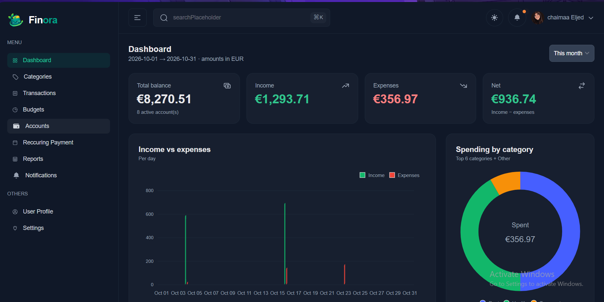
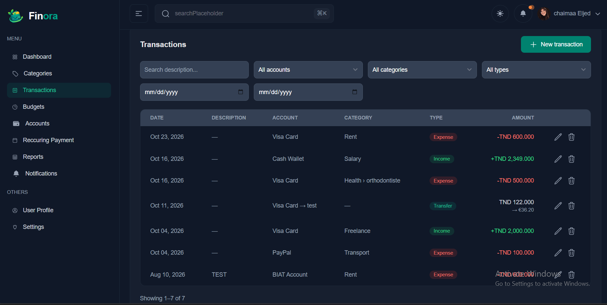
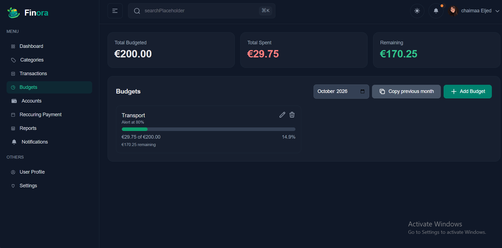
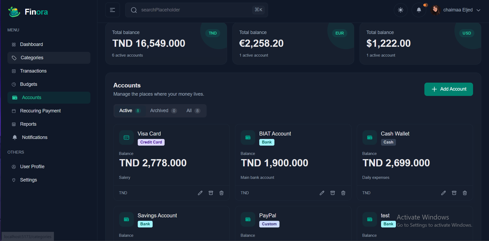

# Money Manager

Full-stack personal finance app: track accounts, transactions, budgets,
recurring payments and savings goals.

## Features
- Email/password auth + Google Sign-In, JWT with refresh tokens
- Multi-account wallets, transactions and multi-currency transfers
- Categories and monthly budgets with alert thresholds
- Dashboard: balance, income vs expenses, spending by category
- Recurring transactions with scheduled cron jobs
- Admin panel: users, roles & permissions, audit logs
- (In progress) Push notifications with FCM, real-time updates via WebSockets

## Tech stack
| Layer | Technologies |
|---|---|
| Backend | NestJS, Prisma, MySQL, Swagger, Socket.IO, NestJS Schedule |
| Frontend | React, TypeScript, Tailwind, TailAdmin (flowbite-react), Zustand, Axios, react-router v7 |
| Services | Firebase Cloud Messaging, Amazon S3 |

## Screenshots
| Dashboard | Transactions |
|---|---|
|  |  |

| Budgets | Admin – Roles |
|---|---|
|  |  |

## Getting started

### Prerequisites
Node 22+, MySQL 8+

### Backend
```bash
cd backend
cp .env.example .env
npm install
npx prisma migrate dev
npm run start:dev
```
API docs: http://localhost:3000/api

### Frontend
```bash
cd frontend
cp .env.example .env
npm install
npm run dev
```

## Project structure
...

## Roadmap
- [x] Auth, accounts, categories, transactions
- [x] Budgets and dashboard
- [x] Recurring transactions and cron
- [ ] Notifications (FCM)
- [ ] WebSockets
- [ ] Goals and reports

## Author
Chaima, [LinkedIn](#) · [Portfolio](#)